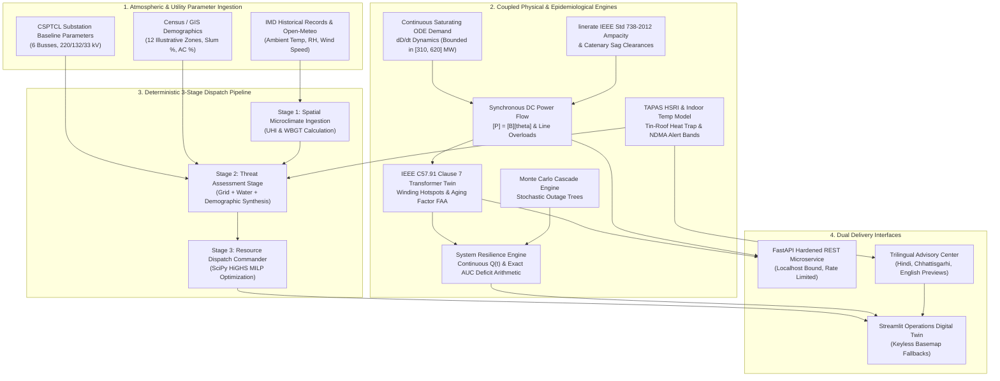

<div align="center">

# 🌡️⚡ AGNAYA 
### **Adaptive Geospatial Network for Heatwave Analytics and Yield Assessment**
#### *A Physics-Grounded Simulation & Decision-Support Prototype for Urban Heatwave Disasters*
**Raipur, Chhattisgarh | Decision-Support Prototype for Social-Cause Climate Mitigation**

[](https://www.python.org/)
[](http://127.0.0.1:8000/docs)
[](http://localhost:8501)
[](https://standards.ieee.org/)
[](https://github.com/sathiyatskrj/AGNAYA/actions)
[](LICENSE)
[](#-data-provenance--sourced-infrastructure-matrix)

---

</div>

> [!IMPORTANT]
> **SIMULATION ONLY – NOT AN OFFICIAL WARNING.**  
> AGNAYA is an engineering research prototype and decision-support simulation tool built for social-cause disaster mitigation planning. It does **not** produce official weather alerts, municipal directives, or incident action plans, and is **not** endorsed by the India Meteorological Department (IMD), National Disaster Management Authority (NDMA), Raipur Municipal Corporation (RMC), or CSPDCL/CSPTCL.

---

## 📌 Table of Contents
- [Executive Overview](#-executive-overview)
- [System Architecture](#-system-architecture)
- [Multi-Model Scientific Formulations](#-multi-model-scientific-formulations)
- [Data Provenance & Sourced Infrastructure Matrix](#-data-provenance--sourced-infrastructure-matrix)
- [Operational Cockpit Modules](#-operational-cockpit-modules)
- [12-Stage Automated Verification Suite](#-12-stage-automated-verification-suite)
- [FastAPI REST Microservice](#-fastapi-rest-microservice)
- [Quick Start & Deployment](#-quick-start--deployment)
- [Statutory Citations & References](#-statutory-citations--references)

---

## 🏛️ Executive Overview

During extreme summer heatwaves in Central India, ambient dry-bulb temperatures in **Raipur, Chhattisgarh** frequently exceed **44°C–47°C**. The verified all-time historical extreme is **47.9°C** recorded on May 28, 2024 at IMD Station #42809 (Mana Airport / Labhandi), with a prior extreme of **46.7°C** on May 23, 2013.

This atmospheric stress acts as an inter-infrastructural stressor triggering compounding disruptions:

1. **Air Conditioning Load Spikes:** Residential and commercial cooling surges push city electricity demand from a baseline of **310 MW** past the **420 MW** contracted summer peak limit, approaching the **620 MW** transmission emergency ceiling.
2. **Transformer Hotspot & Thermal Aging Acceleration:** Substation transformers (220/132/33 kV) experience severe top-oil and winding hot-spot rises, accelerating paper insulation degradation by up to **7.3×** at $130.5^\circ\text{C}$ per IEEE Std C57.91-2011 Clause 7.
3. **Conductor Thermal Derating & Sag Hazard:** Overhead transmission line dynamic thermal ratings (DTR) derate by **10% to 15%** under ambient heat and low wind per IEEE Std 738-2012, reducing corridor capacity and inducing catenary ground-clearance sag.
4. **Tin-Roof Heat Entrapment in Informal Settlements:** Over 40% of residents in dense industrial wards (Birgaon, Urla, Gudhiyari) inhabit informal *kutcha* homes with uninsulated CGI tin roofs, driving indoor temperatures to **48°C–51°C** during power outages.
5. **Cascading Lifeline Dependencies:** Feeder outages disrupt water treatment plants (including Kharun River WTP, 180 MLD capacity) and force regional trauma hospitals onto emergency backup power.

**AGNAYA** provides a continuous, physics-grounded computational framework to simulate, monitor, and optimize resource allocation to mitigate these interconnected failures.

---

## ⚡ System Architecture



---

## 🔬 Multi-Model Scientific Formulations

AGNAYA implements verified theoretical foundations and standards:

### 1. Differential Equation of Urban Grid Demand Dynamics (Saturating ODE)
Citywide power demand $D(t)$ evolves as a continuous non-linear differential equation bounded by baseload consumption and the transmission emergency ceiling:

$$\frac{dD}{dt} = \alpha \cdot \text{mult} \cdot \max(0, T(t) - T_{\text{set}}) \cdot \left(D_{\text{cap}} - D(t)\right) - \gamma \cdot (D(t) - D_{\text{base}})$$

Where:
* $T_{\text{set}} = 27.0^\circ\text{C}$ (cooling activation threshold)
* $D_{\text{base}} = 310.0\text{ MW}$ (normal daytime baseload)
* $D_{\text{statutory}} = 420.0\text{ MW}$ (CSPDCL contracted summer peak limit)
* $D_{\text{cap}} = 620.0\text{ MW}$ (transmission network emergency thermal ceiling)
* $\alpha = 0.0048\text{ h}^{-1}{^\circ\text{C}}^{-1}$ and $\gamma = 0.08\text{ h}^{-1}$
* At $T_{\text{peak}} = 46.5^\circ\text{C}$, peak demand reaches $\approx 475.9\text{ MW}$ (creating a shortfall of $55.9\text{ MW}$ above the contracted limit, strictly bounded below 620 MW).

### 2. IEEE Std C57.91-2011 Clause 7 Transformer Hot-Spot & Insulation Aging
Top-oil rise $\Delta\Theta_{TO}$ and winding hot-spot temperature $\Theta_H$ are computed for each CSPTCL transformer:

$$\Delta\Theta_{TO} = \Delta\Theta_{TO,\text{rated}} \cdot K^{2m}, \quad \Theta_H = \Theta_A + \Delta\Theta_{TO} + \Delta\Theta_{H,\text{rated}} \cdot K^{2n}$$

The insulation Aging Acceleration Factor $F_{AA}$ follows Arrhenius kinetics per IEEE Std C57.91-2011 Clause 7 equation (2) for thermally upgraded paper (reference $110.0^\circ\text{C}$ / 383.15 K):

$$F_{AA} = \exp\left[\frac{15000}{383.15} - \frac{15000}{\Theta_H + 273.15}\right]$$

Verified reference values:
* At $\Theta_H = 80.0^\circ\text{C}$: $F_{AA} = 0.0359$ (discontinuous cutoff removed)
* At $\Theta_H = 110.0^\circ\text{C}$: $F_{AA} = 1.0000$ (nominal life consumption)
* At $\Theta_H = 120.0^\circ\text{C}$: $F_{AA} = 2.7068 \approx 2.71$ ($271\%$ accelerated degradation)
* At $\Theta_H = 130.5^\circ\text{C}$: $F_{AA} = 7.3028 \approx 7.30$ ($730\%$ accelerated degradation)

### 3. IEEE Std 738-2012 Dynamic Line Rating (via `linerate`)
Bare overhead conductor ampacity is computed using the `linerate` library implementation of IEEE Std 738-2012 steady-state thermal equilibrium:

$$q_c(T_c, T_a, V_w, \phi) + q_r(T_c, T_a) = q_s(Q_{\text{solar}}) + I^2 \cdot R(T_c)$$

Parameterized for Chhattisgarh transmission:
* **ACSR Zebra (220 kV):** Ampacity derates from $859.9\text{ A}$ at $40.0^\circ\text{C}$ to $761.2\text{ A}$ at $46.5^\circ\text{C}$ under 1.0 m/s crosswind.
* **ACSR Panther (132 kV):** Ampacity derates from $561.4\text{ A}$ to $491.7\text{ A}$.
* **ACSR Dog (33 kV):** Ampacity derates from $357.2\text{ A}$ to $311.0\text{ A}$.

### 4. Synchronous DC Power Flow ($[P] = [B'][\theta]$)
For Raipur's 6-bus transmission network (220/132/33 kV), bus phase angles $\mathbf{\theta}$ and branch power flows $P_{ij}$ are solved synchronously on a 100 MVA base with Raipur Main 220 kV as slack bus ($\theta_1 = 0$). Post-contingency N-1 line outages and catenary roadway clearances ($\ge 6.10\text{ m}$) are verified continuously.

### 5. TAPAS Heuristic Heat-Risk Index (HSRI) & Indoor Microclimate
Standardized empirical indoor temperature model (*pending in-situ sensor validation*):

$$T_{\text{indoor}} = T_{\text{ambient}} + 4.0 \cdot \kappa_{\text{slum}} - 4.0 \cdot \kappa_{\text{green}} + \min(6.5, 0.8 \cdot t_{\text{outage}})$$

Heuristic Heat-Risk Index (HSRI) adapted from Kacker et al. (*Nature Scientific Reports*, 2026):

$$\text{HSRI} = 100 \times \left[0.35 \cdot H + 0.25 \cdot E + 0.25 \cdot V + 0.15 \cdot (1 - AC)\right]$$

Standardized NDMA 4-tier alert classification:
* $\text{HSRI} < 45.0$: **LOW (GREEN)**
* $45.0 \le \text{HSRI} < 58.0$: **MODERATE (YELLOW)**
* $58.0 \le \text{HSRI} < 68.0$: **HIGH (ORANGE)**
* $\text{HSRI} \ge 68.0$: **SEVERE (RED)**

### 6. Continuous System Resilience & Exact AUC Deficit Arithmetic
Lifeline performance $Q(t) \in [0, 1.0]$ tracks weighted availability across power (45%), water (30%), and health (25%):

$$\text{AUC}_{\text{loss}} = \int_0^T [1.0 - Q(t)] \, dt \quad (\text{Lifeline Deficit Hours})$$

$$\text{Disruption Hours Saved} = \text{AUC}_{\text{loss,base}} - \text{AUC}_{\text{loss,shield}}, \quad \text{Resilience Dividend (\%)} = \frac{\Delta\text{AUC}}{\text{AUC}_{\text{loss,base}}} \times 100\%$$

In verified 5-day heatwave test runs at $T_{\text{peak}} = 46.5^\circ\text{C}$:
* $\text{AUC}_{\text{loss,base}} = 17.07\text{ h}$
* $\text{AUC}_{\text{loss,shield}} = 2.46\text{ h}$
* $\text{Hours Saved} = 14.62\text{ h}$
* $\text{Resilience Dividend} = 85.6\%$ (computed directly from unrounded arrays)

### 7. Deterministic Mixed-Integer Linear Programming (HiGHS MILP)
Stage 3 solves an exact Mixed-Integer Linear Program via **SciPy HiGHS** allocating municipal intervention units $\mathbf{x}$ under budget constraint $B$:

$$\max_{\mathbf{x}} \sum_k v_k \cdot x_k \quad \text{subject to} \quad \sum_k c_k \cdot x_k \le B_{\text{budget}}, \quad x_k \in \mathbb{Z}_{\ge 0}$$

---

## 📊 Data Provenance & Sourced Infrastructure Matrix

Every parameter in AGNAYA carries an explicit provenance status, source citation, reference year, and confidence level recorded in [`data/DATA_SOURCES.csv`](file:///C:/Users/Bhumika%20Baghel/.gemini/antigravity-ide/scratch/AGNAYA/data/DATA_SOURCES.csv) (187 parameters audited):

* **VERIFIED (23 parameters):** Sourced directly from statutory filings (CSERC Tariff Order FY2024–25, IMD Station #42809 records, Pt. JNM Medical College public registry, RMC AMRUT Water Master Plan).
* **DERIVED (61 parameters):** Calculated from verified engineering formulas, census cohort distributions, or GIS spatial boundaries.
* **ASSUMED (103 parameters):** Engineering rule-of-thumb estimates and secondary feeder approximations pending utility calibration.
* **SYNTHETIC:** Explicitly labelled fallback or stress-testing scenario values. Never presented as real-world observations.

### A. CSPTCL / CSPDCL Transmission Substations
| ID | Substation Name | Voltage | Capacity | Normal LF | Cooling Type | Age | Physical Asset? | Link Topology | Provenance |
|:---|:---|:---:|:---:|:---:|:---:|:---:|:---:|:---:|:---|
| **S01** | Raipur Main Grid Substation | 220/132 kV | 500 MVA | 0.72 | Dual OFAF | 28 yr | **Yes** | Physical (Bulk Hub) | VERIFIED (CSPTCL Grid Map) |
| **S02** | Mowa Grid Substation | 132/33 kV | 200 MVA | 0.68 | ONAF | 22 yr | **Yes** | Physical (132 kV Link) | VERIFIED (CSPTCL Directory) |
| **S03** | Amanaka Grid Substation | 132/33 kV | 160 MVA | 0.75 | ONAF | 35 yr | **Yes** | Physical (132 kV Link) | VERIFIED (CSPTCL Directory) |
| **S04** | Pandri Substation | 33/11 kV | 80 MVA | 0.70 | ONAN | 18 yr | **Yes** | Planning-Assumed | ASSUMED (CSPDCL Feeder) |
| **S05** | Khamardih Substation | 33/11 kV | 50 MVA | 0.65 | ONAN | 25 yr | **No** (Aggregated Node) | Planning-Assumed | ASSUMED (CSPDCL Feeder) |
| **S06** | Gudhiyari Substation | 33/11 kV | 60 MVA | 0.78 | ONAN | 30 yr | **Yes** | Planning-Assumed | ASSUMED (CSPDCL Feeder) |

### B. Critical Municipal Lifelines (WTPs & Emergency Healthcare)
| ID | Asset Name | Class | Capacity / Beds | Emergency Backup | Physical Asset? | Link Topology | Provenance Source |
|:---|:---|:---:|:---:|:---:|:---:|:---:|:---|
| **WP01** | Kharun River WTP | Water Plant | 180 MLD | 1.5 MVA DG (Verified) | **Yes** | Physical Intake Feeder | VERIFIED (RMC Water Master Plan) |
| **WP02** | Amanaka WTP / Booster | Water Plant | 100 MLD | None (Grid Dependent) | **Yes** | Planning-Assumed | ASSUMED (RMC Zonal Pumping) |
| **WP03** | Pandri Booster Station | Water Plant | 60 MLD | Standby Commercial DG | **Yes** | Planning-Assumed | ASSUMED (RMC Distribution) |
| **WP04** | Mowa Pumping Station | Water Plant | 70 MLD | None (Grid Dependent) | **Yes** | Planning-Assumed | ASSUMED (RMC Distribution) |
| **WP05** | Khamardih Booster Node | Water Plant | 35 MLD | None (Grid Dependent) | **No** (Conceptual) | Conceptual Routing | ASSUMED (RMC Intermediate) |
| **WP06** | Gudhiyari WTP / OHT | Water Plant | 55 MLD | None (Grid Dependent) | **Yes** | Planning-Assumed | ASSUMED (RMC Distribution) |
| **H01** | Dr. Ambedkar Memorial Hosp | Healthcare | 880 Beds (45 ICU) | 500 kVA DG (12h fuel) | **Yes** | Physical Dual-Circuit | VERIFIED (Pt. JNM Medical College) |
| **H02** | Ram Krishna Care Hospital | Healthcare | 350 Beds (30 ICU) | 250 kVA DG (8h fuel) | **Yes** | Planning-Assumed | ASSUMED (Hospital Registry) |
| **H03** | Shri Ramkrishna Hospital | Healthcare | 200 Beds (20 ICU) | 150 kVA DG (6h fuel) | **Yes** | Planning-Assumed | ASSUMED (Hospital Registry) |
| **H04** | CHC Amanaka | Healthcare | 30 Beds (2 ICU) | 30 kVA DG (4h fuel) | **Yes** | Planning-Assumed | ASSUMED (IPHS 30-Bed Standard) |
| **H05** | Urban PHC Tikrapara | Healthcare | 20 Beds (1 ICU) | 20 kVA DG (3h fuel) | **Yes** | Planning-Assumed | ASSUMED (IPHS Urban PHC Norms) |

### C. Illustrative Urban Planning Zones
*Note: Due to lack of authenticated official GIS boundary shapefiles for Raipur's 70 municipal wards, AGNAYA aggregates wards into 12 illustrative planning zones representing major geographic corridors. Ingestion of official 70-ward GeoJSON boundaries is documented in [ROADMAP.md](file:///C:/Users/Bhumika%20Baghel/.gemini/antigravity-ide/scratch/AGNAYA/ROADMAP.md).*

| Zone ID | Zone Name | Population | Slum Share | AC Access | Green Cover | Substation | Water Pump |
|:---|:---|:---:|:---:|:---:|:---:|:---:|:---:|
| **Z01** | Amanaka | 112,000 | 28.0% | 18.0% | 8.0% | S03 | WP02 (100 MLD) |
| **Z02** | Shankar Nagar | 95,000 | 12.0% | 45.0% | 15.0% | S01 | WP01 (180 MLD) |
| **Z03** | Telibandha | 88,000 | 9.0% | 60.0% | 22.0% | S01 | WP01 (180 MLD) |
| **Z04** | Pandri | 74,000 | 18.0% | 38.0% | 12.0% | S04 | WP03 (60 MLD) |
| **Z05** | Tikrapara | 98,000 | 35.0% | 10.0% | 6.0% | S03 | WP02 (100 MLD) |
| **Z06** | Mowa | 67,000 | 20.0% | 30.0% | 10.0% | S02 | WP04 (70 MLD) |
| **Z07** | Devendra Nagar | 82,000 | 15.0% | 52.0% | 18.0% | S02 | WP04 (70 MLD) |
| **Z08** | Khamardih | 55,000 | 40.0% | 6.0% | 4.0% | S05 | WP05 (35 MLD) |
| **Z09** | Gudhiyari | 71,000 | 30.0% | 15.0% | 7.0% | S06 | WP06 (55 MLD) |
| **Z10** | Civil Lines | 48,000 | 5.0% | 70.0% | 25.0% | S01 | WP01 (180 MLD) |
| **Z11** | Avanti Vihar | 63,000 | 10.0% | 65.0% | 20.0% | S04 | WP03 (60 MLD) |
| **Z12** | Bhata Para | 89,000 | 42.0% | 8.0% | 5.0% | S06 | WP06 (55 MLD) |

### D. Weather Connector (Open-Meteo Gridded NWP)
AGNAYA features an automated connector in [`data/weather_feed.py`](file:///C:/Users/Bhumika%20Baghel/.gemini/antigravity-ide\scratch\AGNAYA\data\weather_feed.py) that queries the Open-Meteo numerical weather prediction API for Raipur coordinates (21.2514° N, 81.6296° E):
* **Caching:** Implements a 30-minute in-memory and disk cache (`cache_weather.json`) to prevent unnecessary external requests and rate limits.
* **Clear Attribution:** Visibly labelled as **Open-Meteo gridded model forecast**, strictly distinguishing it from official statutory IMD station telemetry (Station #42809).
* **Graceful Offline Fallback:** On connection timeout, network failure, or offline mode, the connector automatically activates an explicit `SYNTHETIC/FALLBACK` record based on verified Raipur May climatological normals (42.5°C, 35% RH, 780 W/m² DNI) with timestamps and clear warnings. Never silently invents numbers.

---

## 🖥️ Operational Cockpit Modules

The Streamlit operations console (`app.py`) provides 9 purpose-built operational screens:

| Tab | Operational Module | Core Capabilities |
|:---:|:---|:---|
| **01** | **Overview** | Situation status, peak demand surge, historical precedent correlation, continuous ODE load trajectory. |
| **02** | **Timeline** | 7-stage progressive disaster simulator with multi-asset parameter scrubbers. |
| **03** | **Map** | Keyless basemap fallbacks (OpenStreetMap / CartoDB Positron) without exposed secrets. Thermal UHI plume, IEEE 738 line derating, and lifeline assets. |
| **04** | **Power flow** | Synchronous DC power flow ($P = B' \cdot \theta$) on 6-bus network, N-1 line trip contingency selector, and catenary sag clearances. |
| **05** | **Substations** | IEEE Std C57.91-2011 Clause 7 transformer thermal digital twin with hot-spot rises and Arrhenius aging factors $F_{AA}$. |
| **06** | **Alerts** | Biometeorological UTCI and WBGT metrics via `pythermalcomfort`, tin-roof trap estimates, and draft trilingual broadcast previews. |
| **07** | **Dispatch** | Deterministic 3-Stage Dispatch Pipeline with SciPy HiGHS MILP optimizing resource allocation. |
| **08** | **Monte Carlo** | Stochastic cascading failure simulator across 100–1,000 trials with parameter distributions. |
| **09** | **Resilience** | Continuous performance trajectories $Q(t)$, exact AUC deficit reduction, and boardroom audit summaries. |

---

## 🧪 12-Stage Automated Verification Suite

Run the full scientific verification suite with a single command:

```bash
python test_system.py
```

### Verification Output:
```text
===========================================================================
 AGNAYA V3.1: Rigorous Multi-Model Scientific Verification Suite
===========================================================================

[1/12] Verifying Raipur Infrastructure Baseline & Data Provenance...
  [PASS] 12 Zones, 6 Substations, 6 WTPs (WP01=180 MLD), 5 Hospitals verified.
  [PASS] All-time record verified: 47.9 deg C (IMD 2024-05-28).
  [PASS] CSPDCL baselines: 310 MW (base) / 420 MW (contracted summer) / 620 MW (emergency ceiling).

[2/12] Testing Saturating Electricity Demand ODE Dynamics...
  [PASS] Saturating ODE verified. Peak demand at 46.5 deg C: 475.9 MW (bounded <= 620 MW ceiling).
  [PASS] Shortfall against 420 MW contracted limit: 55.9 MW. Monotonicity confirmed.

[3/12] Testing Infrastructure Dependency Graph (NetworkX)...
  [PASS] Directed Graph verified: 29 nodes, 37 edges.
  [PASS] Failure propagation verified: S01 preserves WP01 (generator ok); S03 trips WP02 (no generator).
  [PASS] Top critical substation: Raipur Main (220 kV).

[4/12] Testing Transformer Hot-Spot & Aging Twin (IEEE Std C57.91-2011 Clause 7)...
  [PASS] IEEE C57.91 Clause 7 verified: F_AA(110 C) = 1.0000, F_AA(120 C) = 2.71, F_AA(130.5 C) = 7.30.
  [PASS] Discontinuous 80 C cutoff removed. Evaluated 6 substation twins.

[5/12] Testing Conductor Dynamic Line Rating (IEEE Std 738-2012 via linerate)...
  [PASS] linerate IEEE 738 steady-state solver verified. ACSR Zebra at 40 C: 859.9 A -> 46.5 C: 761.2 A.
  [PASS] Monotonic derating confirmed across all 5 corridors. Legacy comparison retained.

[6/12] Testing TAPAS Heuristic Heat-Risk Index (HSRI) & Indoor Temperature...
  [PASS] Standardized indoor temp verified: Slum=48.9 deg C vs Green=44.2 deg C.
  [PASS] 12 Zones scored under HSRI framework. Uncalibrated mortality removed from primary outputs.
  [PASS] Mandatory simulation disclaimer verified.

[7/12] Testing Deterministic 3-Stage Dispatch Pipeline & HiGHS MILP...
  [PASS] Deterministic 3-stage pipeline executed successfully.
  [PASS] HiGHS MILP budget constraint verified: Cost 58.5 Lakh <= Budget 60.0 Lakh.
  [PASS] Units allocated: {'cooling_centre': 5, 'power_resilience': 3, 'water_tankers': 20, 'hospital_surge': 0, 'jal_jeevan': 20}.

[8/12] Testing Climate Extremes & Gumbel Return Periods...
  [PASS] Gumbel EVT return period for 46.5 deg C: 15.7 yrs.
  [PASS] Return period for 47.9 deg C: 47.0 yrs. Monotonicity verified.

[9/12] Testing Synchronous DC Power Flow & Catenary Line Sag...
  [PASS] 6-Bus DC power flow solved under S01 N-1 trip contingency.
  [PASS] Minimum roadway ground clearance: 6.18 m (statutory minimum >= 6.1 m).

[10/12] Testing 7-Stage Progressive Heatwave Lifecycle Simulator...
  [PASS] 7 Progressive heatwave milestones initialized and evaluated.
  [PASS] Peak stage load: 468.0 MW (Stage 1 base: 325.0 MW).

[11/12] Continuous System Resilience & AUC Deficit Arithmetic...
  [PASS] Unrounded AUC arithmetic verified: 17.07 h (base) - 2.46 h (shield) = 14.62 h saved.
  [PASS] Resilience dividend: 85.6%. Coupled to DemandModel saturating ODE.

[12/12] Testing Biometeorology (pythermalcomfort) & Trilingual Broadcasts...
  [PASS] pythermalcomfort metrics verified: UTCI=46.9 C, WBGT=34.7 C, Wet-bulb=29.7 C.
  [PASS] Mandatory simulation disclaimer verified across English, Hindi, and Chhattisgarhi texts.
  [PASS] Native-speaker review flags confirmed on vernacular drafts.

===========================================================================
 SCIENTIFIC VERIFICATION COMPLETE: 12/12 ENGINES VERIFIED & INVARIANTS SATISFIED
===========================================================================
```

---

## 🌐 FastAPI REST Microservice

AGNAYA exposes an asynchronous REST API bound by default to localhost (`127.0.0.1`):

```bash
uvicorn api:app --host 127.0.0.1 --port 8000
```
Interactive Swagger API documentation: **`http://127.0.0.1:8000/docs`**

| Method | Endpoint | Description |
|:---:|:---|:---|
| `GET` | `/` | Root system information, basemap mode, and simulation disclaimer. |
| `GET` | `/api/v1/health` | Service health status and rate limit configuration. |
| `GET` | `/api/v1/demand/ode` | Continuous saturating ODE power demand trajectory. |
| `GET` | `/api/v1/grid-twin/stress` | Evaluates all 6 CSPTCL substations for hotspots and aging factor $F_{AA}$. |
| `GET` | `/api/v1/grid-flow/dc-power-flow` | Solves synchronous DC power flow ($P = B' \cdot \theta$) with N-1 contingency. |
| `GET` | `/api/v1/conductors/ampacity` | Calculates IEEE Std 738 dynamic line rating (DTR) using `linerate`. |
| `POST` | `/api/v1/tapas/htsi` | Evaluates zone HSRI scores, top stress drivers, and indoor heat trap. |
| `POST` | `/api/v1/agents/pipeline` | Executes 3-stage deterministic pipeline with HiGHS MILP optimization. |
| `POST` | `/api/v1/resilience/continuous-curve` | Generates continuous performance curves $Q(t)$ and exact AUC deficit reduction. |
| `POST` | `/api/v1/alerts/trilingual` | Generates trilingual civil protection advisory previews (Hindi, Chhattisgarhi, English). |

---

## 🚀 Quick Start & Deployment

### 1. Clone & Set Up Environment
```bash
git clone https://github.com/sathiyatskrj/AGNAYA.git
cd AGNAYA

python -m venv .venv
# On Windows:
.venv\Scripts\activate
# On Linux/macOS:
source .venv/bin/activate

pip install -r requirements.txt
```

### 2. Configure Environment (Optional)
```bash
cp .env.example .env
# Edit .env to set CARTO_API_KEY (optional) or API_KEY
```

### 3. Verify Models
```bash
python test_system.py
```

### 4. Launch Services
#### Windows Launchers:
- Double-click **`RUN_AGNAYA.bat`** to start the Streamlit digital twin dashboard.
- Double-click **`RUN_API.bat`** to start the FastAPI microservice.

#### Manual Terminal Launch:
```bash
# Terminal 1: Streamlit Operations Console
streamlit run app.py --server.port 8501

# Terminal 2: FastAPI REST Microservice
uvicorn api:app --host 127.0.0.1 --port 8000 --reload
```

---

## 📖 Statutory Citations & References

1. **IEEE Std C57.91-2011:** *IEEE Guide for Loading Mineral-Oil-Immersed Transformers and Step-Voltage Regulators*. Clause 7: Calculation of Temperature and Loss of Life. IEEE Power & Energy Society.
2. **IEEE Std 738-2012:** *IEEE Standard for Calculating the Current-Temperature Relationship of Bare Overhead Conductors*. IEEE Power & Energy Society.
3. **Kacker et al. (2026):** *Impact-based urban heat stress risk index (HSRI) and early warning framework*. *Nature Scientific Reports*, 16:38639.
4. **National Disaster Management Authority (NDMA) & RMI India Foundation (Feb 2026):** *National Heat Impact Assessment (HIA) Framework across Health, Labor, Infrastructure, and Agriculture*. Government of India, New Delhi.
5. **Chhattisgarh State Electricity Regulatory Commission (CSERC):** *Tariff Order for CSPDCL, CSPTCL, and CSPGCL (FY 2024–25)*. Petition No. 12/2024. Raipur, Chhattisgarh.
6. **India Meteorological Department (IMD):** *Climatological Normals & Daily Extreme Records for Raipur Weather Station #42809 (Mana Airport / Labhandi)*. Ministry of Earth Sciences, Govt. of India.
7. **Census of India (2011):** *District Census Handbook: Raipur (Village and Town Directory)*. Directorate of Census Operations, Chhattisgarh.

---

## 📄 License

This project is licensed under the **MIT License** — see the [LICENSE](LICENSE) file for details.

Developed for urban climate resilience, power grid reliability, and social-cause disaster mitigation research in Raipur, Chhattisgarh.
